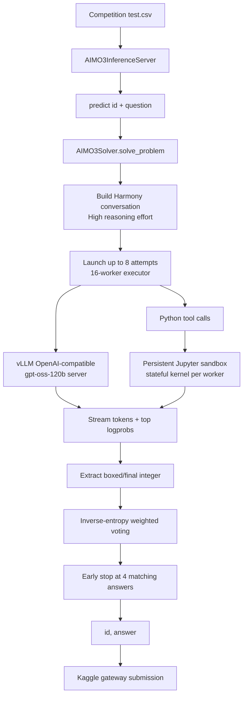

# 🏆 AI Mathematical Olympiad - Progress Prize 3 — Bronze Medal, Rank 383/4,138

<p align="center">
  <a href="https://img.shields.io/badge/Kaggle-Competition-20BEFF?logo=kaggle&logoColor=white&style=flat-square"></a>
  <a href="https://img.shields.io/badge/Award-Bronze%20%7C%20383%2F4138-CD7F32?style=flat-square"></a>
  <a href="https://img.shields.io/badge/Output-Integer%20answer-555555?style=flat-square"></a>
  <a href="https://img.shields.io/badge/Python-3.12-3776AB?logo=python&logoColor=white&style=flat-square"></a>
  <a href="https://img.shields.io/badge/Stack-vLLM%20%7C%20OpenAI%20Harmony-8A2BE2?style=flat-square"></a>
  <a href="https://img.shields.io/badge/License-Not%20specified-lightgrey?style=flat-square"></a>
</p>

<p align="center"><b>English</b> | <a href="./README_zh.md">简体中文</a></p>

<div align="center">
  <a href="https://storage.googleapis.com/kaggle-competition-certificates/31156518/e696320b032f63ca962307d94bbe0394.png">
    
  </a>
  <p><em>🏅 Official Kaggle Competition Award Certificate — Bronze Medal, 383rd of 4,138 teams</em></p>
</div>

## 1. Executive Summary

This repository preserves the downloaded Kaggle notebook for **AI Mathematical Olympiad - Progress Prize 3**. The archived submission is an inference system rather than a conventional supervised-learning training pipeline: a locally served `gpt-oss-120b` model solves each olympiad problem, calls a stateful Python/Jupyter sandbox when needed, and aggregates multiple attempts into one integer answer.

The tracked Notebook keeps its source cells and runtime metadata; generated cell outputs are intentionally stripped to keep the repository reviewable and avoid storing transient logs or visualizations.

### Problem and Core Challenges

- **Task:** generate one non-negative integer answer per problem, constrained by the system prompt to `0..99999` and formatted inside `\boxed{}`.
- **Input contract:** Kaggle's AIMO-3 inference server supplies `id` and `question` rows.
- **Execution constraints:** the notebook manages a finite global time budget, per-problem deadlines, model serving startup, concurrent attempts, and sandbox timeouts.
- **Official metric:** the exact competition metric is not encoded in this repository; `[TODO: record the official AIMO-3 metric definition]`.

### Winning Approach Overview

The notebook loads a local `gpt-oss-120b` checkpoint into a vLLM OpenAI-compatible server. Each problem is solved with up to eight concurrent reasoning attempts, each using OpenAI Harmony formatting and a stateful Python tool backed by a persistent Jupyter kernel. Answers are extracted from `\boxed{...}` or a `final answer is ...` pattern. The final answer is selected by inverse-entropy weighted voting, with early stopping once four valid attempts agree.

## 2. Solution Architecture and Pipeline



### Pipeline Stages

1. **Runtime bootstrap:** `set_env()` installs offline wheels for `unsloth`, `trl`, `vllm`, and `openai_harmony` from `/kaggle/input/aimo-3-utils/wheels.tar.gz`.
2. **Model serving:** `AIMO3Solver` starts a local vLLM server with one tensor-parallel shard, prefix caching, asynchronous scheduling, `fp8_e4m3` KV cache, and a 65,536-token context.
3. **Tool-augmented reasoning:** `AIMO3Sandbox` owns a stateful Jupyter kernel. The `python` tool requires `print()` output and returns execution errors or results to the Harmony conversation.
4. **Parallel attempts:** eight attempts are submitted to a 16-worker executor. Each attempt receives a deterministic derived seed and may run for multiple tool/model turns.
5. **Answer selection:** valid integers are ranked by accumulated inverse mean token entropy, while a four-vote agreement can stop remaining work.

## 3. Key Technical Insights

### 3.1 Validation Strategy

There is **no supervised training, cross-validation split, OOF table, or loss function** in the archived notebook. The relevant reliability mechanisms are runtime-level:

- answer-format validation through `\\boxed{([0-9,]+)}` and `final answer is ...` parsing;
- range validation for the latter pattern (`0 <= answer <= 99999`);
- multiple independent attempts with deterministic per-attempt seeds;
- inverse-entropy weighted aggregation and an early-stop vote threshold.

### 3.2 Data Processing and Tooling

- The input question is passed directly into the solver; no tabular feature engineering or augmentation is implemented.
- The system prompt explicitly exposes `math`, `numpy`, and `sympy` through the Python environment.
- The sandbox resets its Jupyter namespace between problems while retaining state within a problem's tool interaction.
- Error traces are normalized before being returned to the model, and execution is interrupted after the configured timeout.

### 3.3 Model Design and Runtime Configuration

The implementation is an inference-time systems design, not a trainable model definition.

| Component | Code-backed setting |
| --- | --- |
| Model | Local `gpt-oss-120b` checkpoint at `/kaggle/input/gpt-oss-120b/transformers/default/1` |
| Serving | `vllm.entrypoints.openai.api_server` |
| Tensor parallelism | `1` |
| GPU memory utilization | `0.96` |
| KV cache | `fp8_e4m3` |
| Context length | `65,536` tokens |
| Maximum concurrent sequences | `256` |
| Sampling | `temperature=1.0`, `min_p=0.02`, `top_logprobs=5` |
| Reasoning | OpenAI Harmony `ReasoningEffort.HIGH` |
| Per-problem attempts | `8` |
| Executor workers | `16` |
| Maximum turns per attempt | `128` |
| Base/high problem timeout | `300` / `900` seconds |

### 3.4 Ensembling and Post-processing

The notebook performs **answer-level ensembling**, not probability blending:

1. Parse each attempt into an integer answer.
2. Compute mean entropy from streamed top-logprob dictionaries.
3. Add `1 / max(entropy, 1e-9)` to the answer's weight.
4. Select the answer with the largest accumulated weight.
5. Return `0` only when no valid answer was extracted.

### 3.5 What Did Not Work / Open Ablations

- `[TODO]` Record single-attempt versus multi-attempt ablation.
- `[TODO]` Record the effect of Python tool access versus no tool access.
- `[TODO]` Record the effect of entropy weighting versus unweighted majority vote.
- `[TODO]` Record timeout and concurrency sensitivity under the official runtime limit.

## 4. Validation and Ablation Results

The repository contains the final archived notebook and certificate evidence, but not a complete experiment ledger. The table below is intentionally explicit about missing measurements.

| Stage / Experiment | Key Changes | Local CV | Public LB | Private LB |
| :--- | :--- | :---: | :---: | :---: |
| Baseline | Single `gpt-oss-120b` answer extraction | N/A | `[TODO]` | `[TODO]` |
| Tool-augmented solver | Stateful Jupyter Python tool with Harmony tool calls | N/A | `[TODO]` | `[TODO]` |
| Multi-attempt solver | Eight parallel attempts with early stopping | N/A | `[TODO]` | `[TODO]` |
| Final archived notebook | Inverse-entropy weighted answer voting | N/A | `[TODO]` | `[TODO]` |

The verified award record is **Bronze Medal, rank 383 of 4,138 teams**, awarded **April 16, 2026**. This is certificate evidence, not a substitute for a missing score ledger.

## 5. Repository Structure

```text
.
├── assets/
│   └── certificate.png                 # README Hero image; linked to Kaggle's certificate asset
├── evidence/
│   ├── aimo-3-bronze-certificate.png   # Archived certificate image
│   └── links.md                         # Official competition, notebook, and certificate links
├── submission/
│   └── aimo-3-gpt-oss-120b-with-tools.ipynb
│                                         # Downloaded Kaggle inference notebook
├── README.md                            # English technical documentation
└── README_zh.md                         # Simplified Chinese technical documentation
```

## 6. Environment and Reproducibility

### 6.1 Hardware and Runtime

- Notebook metadata declares an NVIDIA H100 accelerator.
- The code explicitly exposes one CUDA device and starts vLLM with `--tensor-parallel-size 1`.
- `[TODO: record actual GPU model, VRAM, cold-start time, and per-problem throughput]`.

### 6.2 Installation

The notebook is designed for Kaggle's offline runtime and does not ship a local `requirements.txt`. Its actual bootstrap step is:

```python
set_env(
    input_archive="/kaggle/input/aimo-3-utils/wheels.tar.gz",
    temp_dir="/kaggle/tmp/setup",
)
# Installs from the offline wheel directory:
# unsloth, trl, vllm, openai_harmony
```

The notebook also imports `pandas`, `polars`, `openai`, `transformers`, `jupyter_client`, and `kaggle_evaluation`.

### 6.3 Data and Model Preparation

Attach the following Kaggle inputs with the same paths used by the notebook:

- Competition input: `/kaggle/input/ai-mathematical-olympiad-progress-prize-3/test.csv`
- Offline utilities: `/kaggle/input/aimo-3-utils/wheels.tar.gz`
- Model input: `/kaggle/input/gpt-oss-120b/transformers/default/1`

No training dataset, checkpoint conversion script, credentials, or external API key is included in this repository.

### 6.4 Running the Archived Submission

There is no standalone `train.py` or local CLI. Open the archived notebook in Kaggle and run all cells. The final cells instantiate the solver and register:

```python
solver = AIMO3Solver(CFG)
inference_server = kaggle_evaluation.aimo_3_inference_server.AIMO3InferenceServer(predict)

if os.getenv("KAGGLE_IS_COMPETITION_RERUN"):
    inference_server.serve()
else:
    inference_server.run_local_gateway(
        ("/kaggle/input/ai-mathematical-olympiad-progress-prize-3/test.csv",)
    )
```

### 6.5 Reproducibility Boundaries

The notebook depends on Kaggle-specific input mounts, an offline wheel bundle, a large model checkpoint, CUDA/vLLM compatibility, and the official inference server. Re-running outside Kaggle requires reproducing those runtime contracts.

## Official Links

- [Competition](https://www.kaggle.com/competitions/ai-mathematical-olympiad-progress-prize-3)
- [Kaggle notebook](https://www.kaggle.com/code/ydhdhej/aimo-3-gpt-oss-120b-with-tools)
- [Official certificate page](https://www.kaggle.com/certification/competitions/ydhdhej/ai-mathematical-olympiad-progress-prize-3)
- [Official certificate image](https://storage.googleapis.com/kaggle-competition-certificates/31156518/e696320b032f63ca962307d94bbe0394.png)
