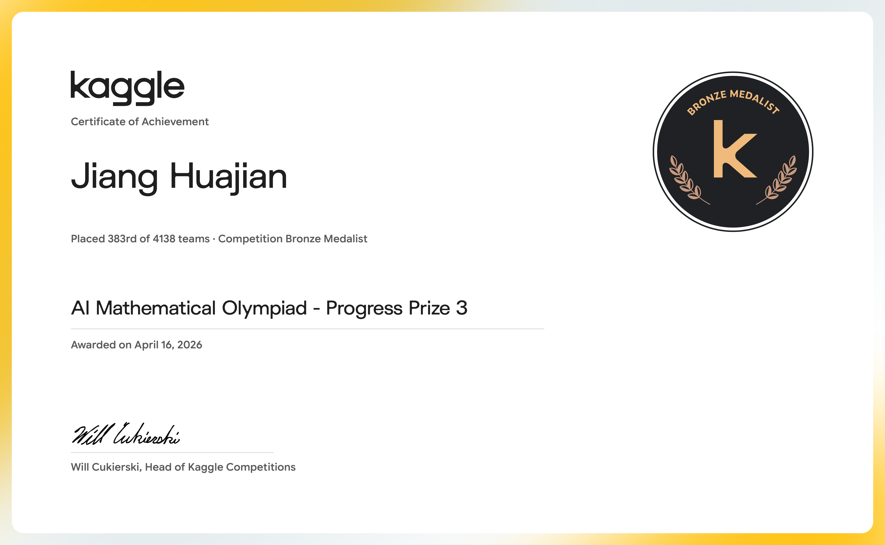

# AI Mathematical Olympiad - Progress Prize 3

<p align="center">
  <a href="https://storage.googleapis.com/kaggle-competition-certificates/31156518/e696320b032f63ca962307d94bbe0394.png">
    
  </a>
</p>

<p align="center">
  <strong>Bronze Medal</strong> · 383rd of 4,138 teams · Awarded April 16, 2026
</p>

This repository is a focused, reproducible archive of the selected Kaggle
submission for **AI Mathematical Olympiad - Progress Prize 3**. The notebook
is preserved as downloaded; the certificate and official links are included so
the result can be checked independently.

## Result Summary

| Field | Record |
| --- | --- |
| Competition | AI Mathematical Olympiad - Progress Prize 3 |
| Result | Bronze Medal |
| Final rank | 383 / 4,138 teams |
| Certificate date | April 16, 2026 |
| Kaggle source account | `ydhdhej` |
| Notebook status | Archived Kaggle notebook download |

## Submission

- Notebook: [`aimo-3-gpt-oss-120b-with-tools.ipynb`](submission/aimo-3-gpt-oss-120b-with-tools.ipynb)
- Kaggle notebook: [Open the original Kaggle notebook](https://www.kaggle.com/code/ydhdhej/aimo-3-gpt-oss-120b-with-tools)
- Competition page: [Open the official competition page](https://www.kaggle.com/competitions/ai-mathematical-olympiad-progress-prize-3)

## Certificate

The certificate image above opens the official Kaggle-hosted certificate.
The original certificate asset is also available at
[`evidence/aimo-3-bronze-certificate.png`](evidence/aimo-3-bronze-certificate.png).

## Repository Layout

```text
.
├── evidence/
│   ├── aimo-3-bronze-certificate.png
│   └── links.md
├── submission/
│   └── aimo-3-gpt-oss-120b-with-tools.ipynb
└── README.md
```

## Scope and Reproducibility

This archive contains the notebook and certificate evidence only. Kaggle
datasets, model weights, credentials, private runtime outputs, and external
services are intentionally excluded. Re-running the notebook may therefore
require restoring the original Kaggle data sources and accelerator settings.

## Official Links

- [Competition](https://www.kaggle.com/competitions/ai-mathematical-olympiad-progress-prize-3)
- [Kaggle notebook](https://www.kaggle.com/code/ydhdhej/aimo-3-gpt-oss-120b-with-tools)
- [Official certificate image](https://storage.googleapis.com/kaggle-competition-certificates/31156518/e696320b032f63ca962307d94bbe0394.png)
