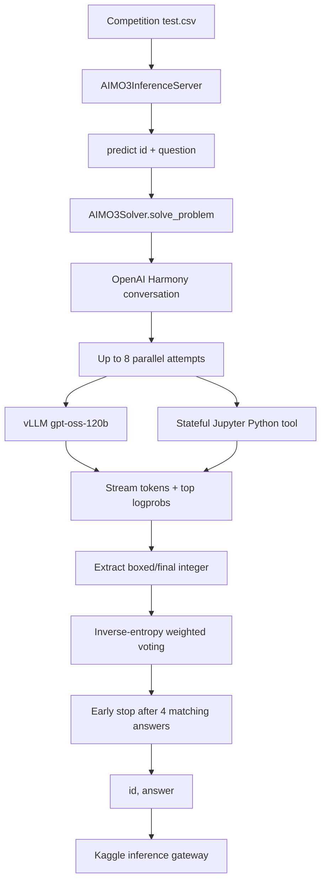

# AI Mathematical Olympiad – Progress Prize 3

<p align="center">
  <a href="https://www.kaggle.com/competitions/ai-mathematical-olympiad-progress-prize-3"></a>
  <a href="https://www.kaggle.com/certification/competitions/ydhdhej/ai-mathematical-olympiad-progress-prize-3"></a>
  
  
  
  
</p>

<p align="center"><b>English</b> | <a href="./README_zh.md">简体中文</a></p>

<div align="center">
  <a href="https://www.kaggle.com/certification/competitions/ydhdhej/ai-mathematical-olympiad-progress-prize-3">
    
  </a>
  <p><em>Official Kaggle award certificate — Bronze Medal, rank 383 of 4,138 teams</em></p>
</div>

## Overview

This repository preserves the archived Kaggle inference notebook for **AI Mathematical Olympiad – Progress Prize 3**. It is an inference-time reasoning system rather than a conventional supervised-learning training project: a locally served `gpt-oss-120b` model solves olympiad problems, uses a stateful Python/Jupyter sandbox when useful, and aggregates multiple candidate answers into one integer submission.

### Highlights

- **Model serving:** local `gpt-oss-120b` inference through vLLM with OpenAI Harmony message formatting.
- **Tool use:** persistent per-worker Jupyter kernels exposing `math`, `numpy`, and `sympy` for executable reasoning.
- **Inference scaling:** up to eight reasoning attempts scheduled across a 16-worker executor, with deterministic derived seeds.
- **Answer aggregation:** inverse-entropy weighted voting with early stopping after four matching valid answers.
- **Award evidence:** Bronze Medal, rank 383 of 4,138 teams; the certificate and official links are archived under `evidence/`.

The notebook emits one non-negative integer answer per problem in the format required by the competition inference server. The complete leaderboard metric definition is maintained by Kaggle; this archive focuses on the executable submission pipeline and does not invent missing local experiment scores.

## Architecture



## Technical Implementation

### Runtime bootstrap

The notebook installs its offline runtime from the Kaggle input mount:

```python
set_env(
    input_archive="/kaggle/input/aimo-3-utils/wheels.tar.gz",
    temp_dir="/kaggle/tmp/setup",
)
```

The bootstrap bundle provides `unsloth`, `trl`, `vllm`, and `openai_harmony`; the notebook also imports `pandas`, `polars`, `openai`, `transformers`, `jupyter_client`, and `kaggle_evaluation`.

### Reasoning and sandbox execution

Each problem is converted into an OpenAI Harmony conversation with high reasoning effort. The solver can call a stateful Python tool backed by a persistent Jupyter kernel. Tool output and execution errors are returned to the model, while the namespace is reset between problems to prevent cross-problem state leakage.

### Parallel attempts and selection

The final archived configuration launches up to eight attempts on a 16-worker executor. Each attempt uses a deterministic derived seed. Candidate outputs are parsed from `\\boxed{...}` or `final answer is ...`; valid integers are range-checked against `0..99999`. The final answer is selected by accumulating `1 / max(mean_entropy, 1e-9)` for each candidate and stopping early when four valid attempts agree.

### Runtime configuration

| Component | Archived setting |
| --- | --- |
| Model | `gpt-oss-120b` |
| Serving | vLLM OpenAI-compatible server |
| Tensor parallelism | `1` |
| GPU memory utilization | `0.96` |
| KV cache | `fp8_e4m3` |
| Context length | `65,536` tokens |
| Attempts per problem | `8` |
| Executor workers | `16` |
| Maximum turns per attempt | `128` |
| Base / high timeout | `300` / `900` seconds |

## Evaluation and Evidence

This archive contains the final notebook, certificate evidence, and official links. It does not contain a supervised-training CV table or a complete ablation ledger because the submitted system was an inference pipeline. Missing leaderboard diagnostics are intentionally omitted rather than filled with estimates.

| Evidence | Record |
| --- | --- |
| Award | Bronze Medal |
| Rank | 383 / 4,138 teams |
| Submission type | Kaggle inference notebook |
| Local CV | Not applicable to the archived inference-only system |
| Official certificate | `evidence/aimo-3-bronze-certificate.png` |

## Repository Structure

```text
.
├── assets/
│   └── certificate.png                 # README hero image
├── evidence/
│   ├── aimo-3-bronze-certificate.png   # Archived certificate image
│   └── links.md                         # Competition, notebook, and certificate links
├── submission/
│   └── aimo-3-gpt-oss-120b-with-tools.ipynb
│                                         # Downloaded Kaggle inference notebook
├── README.md                            # English documentation
└── README_zh.md                         # Simplified Chinese documentation
```

## Reproducibility

### Kaggle inputs

Mount the following inputs using the paths expected by the notebook:

```text
/kaggle/input/ai-mathematical-olympiad-progress-prize-3/test.csv
/kaggle/input/aimo-3-utils/wheels.tar.gz
/kaggle/input/gpt-oss-120b/transformers/default/1
```

### Running the archived submission

There is no standalone `train.py` or local CLI. Open the notebook in Kaggle and run all cells. The final entry point is:

```python
solver = AIMO3Solver(CFG)
inference_server = kaggle_evaluation.aimo_3_inference_server.AIMO3InferenceServer(predict)

if os.getenv("KAGGLE_IS_COMPETITION_RERUN"):
    inference_server.serve()
else:
    inference_server.run_local_gateway(
        ("/kaggle/input/ai-mathematical-olympiad-progress-prize-3/test.csv",)
    )
```

### Reproduction boundary

Reproduction outside Kaggle requires the offline wheel bundle, the large model checkpoint, CUDA/vLLM compatibility, and the official inference-server contract. These runtime dependencies are not included in the repository.

## Official Links

- [Competition](https://www.kaggle.com/competitions/ai-mathematical-olympiad-progress-prize-3)
- [Kaggle notebook](https://www.kaggle.com/code/ydhdhej/aimo-3-gpt-oss-120b-with-tools)
- [Official certificate page](https://www.kaggle.com/certification/competitions/ydhdhej/ai-mathematical-olympiad-progress-prize-3)
- [Official certificate image](https://storage.googleapis.com/kaggle-competition-certificates/31156518/e696320b032f63ca962307d94bbe0394.png)
