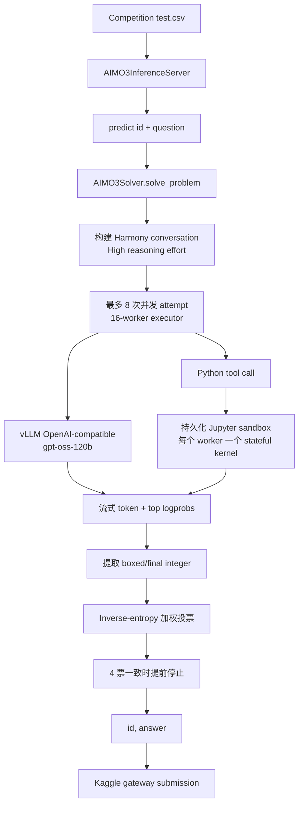

# 🏆 AI Mathematical Olympiad - Progress Prize 3 — Bronze Medal，383/4,138

<p align="center">
  <a href="https://img.shields.io/badge/Kaggle-Competition-20BEFF?logo=kaggle&logoColor=white&style=flat-square"></a>
  <a href="https://img.shields.io/badge/Award-Bronze%20%7C%20383%2F4138-CD7F32?style=flat-square"></a>
  <a href="https://img.shields.io/badge/Output-Integer%20answer-555555?style=flat-square"></a>
  <a href="https://img.shields.io/badge/Python-3.12-3776AB?logo=python&logoColor=white&style=flat-square"></a>
  <a href="https://img.shields.io/badge/Stack-vLLM%20%7C%20OpenAI%20Harmony-8A2BE2?style=flat-square"></a>
  <a href="https://img.shields.io/badge/License-Not%20specified-lightgrey?style=flat-square"></a>
</p>

<p align="center"><a href="./README.md">English</a> | <b>简体中文</b></p>

<div align="center">
  <a href="https://storage.googleapis.com/kaggle-competition-certificates/31156518/e696320b032f63ca962307d94bbe0394.png">
    
  </a>
  <p><em>🏅 Kaggle 官方竞赛奖状：Bronze Medal，4,138 支队伍中排名第 383</em></p>
</div>

## 1. 方案核心摘要

本仓库保存 **AI Mathematical Olympiad - Progress Prize 3** 的 Kaggle Notebook 原始归档。该方案不是传统的 supervised-learning 训练流程，而是一个 inference-time reasoning system：加载本地 `gpt-oss-120b`，通过 vLLM 提供 OpenAI-compatible 服务；模型在需要时调用有状态的 Python/Jupyter sandbox；最后对多次尝试的整数答案进行聚合。

归档 Notebook 保留 source cells 与 runtime metadata；为保持仓库可审阅并避免保存临时日志/可视化，已清理生成的 cell outputs。

### 赛题与核心挑战

- **任务：** 为每道数学题输出一个非负整数，系统提示约束答案范围为 `0..99999`，并要求放在 `\boxed{}` 中。
- **输入：** Kaggle AIMO-3 inference server 提供 `id` 与 `question`。
- **运行约束：** 需要管理模型服务启动、并发尝试、Python sandbox 超时、单题 deadline 和整个 Notebook 的时间预算。
- **官方 Metric：** 仓库没有保存完整的官方评分定义，暂留 `[TODO: 补充 AIMO-3 官方 Metric]`。

### 核心方案

Notebook 将 `gpt-oss-120b` checkpoint 启动为本地 vLLM OpenAI-compatible server。每道题最多并发执行 8 次 reasoning attempt，使用 OpenAI Harmony prompt，并通过持久化 Jupyter kernel 提供 Python 工具。答案先从 `\boxed{...}` 或 `final answer is ...` 中提取，再按平均 token entropy 的倒数进行加权投票；当有 4 次有效答案一致时提前停止。

## 2. 整体架构与流水线



### 各阶段逻辑

1. **Runtime bootstrap：** `set_env()` 从 `/kaggle/input/aimo-3-utils/wheels.tar.gz` 的离线 wheel 安装 `unsloth`、`trl`、`vllm` 与 `openai_harmony`。
2. **Model serving：** `AIMO3Solver` 启动本地 vLLM，使用单路 tensor parallel、prefix caching、async scheduling、`fp8_e4m3` KV cache 和 65,536 token context。
3. **Tool-augmented reasoning：** `AIMO3Sandbox` 管理 stateful Jupyter kernel；`python` tool 要求使用 `print()` 输出，并将结果或错误返回给 Harmony conversation。
4. **并发尝试：** 8 次 attempt 提交到 16-worker executor，每次使用确定性的 derived seed，并可执行多轮 model/tool interaction。
5. **答案选择：** 从输出中提取合法整数，按 inverse mean token entropy 累积权重，并支持四票一致提前结束。

## 3. 核心技术细节

### 3.1 Validation Strategy

该 Notebook **没有 supervised training、CV split、OOF 或训练 Loss**。它采用的是 runtime-level reliability strategy：

- 通过 `\\boxed{([0-9,]+)}` 与 `final answer is ...` 做格式解析；
- 对后者执行 `0 <= answer <= 99999` 的范围检查；
- 使用多个独立 attempt 与确定性 derived seed；
- 通过 inverse-entropy weighted voting 和 early-stop vote threshold 提高稳定性。

### 3.2 数据处理与工具环境

- 题目文本直接送入 solver，没有表格特征工程或 data augmentation。
- System prompt 明确声明可使用 `math`、`numpy` 与 `sympy`。
- Sandbox 在题目内部保持状态，在题目之间 reset Jupyter namespace。
- Notebook 会在超时后 interrupt kernel，并对错误 traceback 做格式化后返回。

### 3.3 Model 与运行配置

| 组件 | 代码中的实际配置 |
| --- | --- |
| Model | `/kaggle/input/gpt-oss-120b/transformers/default/1` 下的 `gpt-oss-120b` |
| Serving | `vllm.entrypoints.openai.api_server` |
| Tensor parallel | `1` |
| GPU memory utilization | `0.96` |
| KV cache | `fp8_e4m3` |
| Context length | `65,536` tokens |
| 最大并发序列 | `256` |
| Sampling | `temperature=1.0`、`min_p=0.02`、`top_logprobs=5` |
| Reasoning | OpenAI Harmony `ReasoningEffort.HIGH` |
| 每题 attempts | `8` |
| Executor workers | `16` |
| 单次 attempt 最大 turns | `128` |
| Base/high timeout | `300` / `900` 秒 |

### 3.4 Ensembling 与 Post-processing

这里是 **answer-level ensembling**，不是概率融合：

1. 将每次 attempt 解析为整数答案；
2. 从 streamed top-logprob 计算平均 entropy；
3. 为每个答案累加 `1 / max(entropy, 1e-9)`；
4. 选择累计权重最大的答案；
5. 如果没有合法答案，返回 `0`。

### 3.5 未采用方案与待补实验

- `[TODO]` 补充 single-attempt 与 multi-attempt 的 ablation。
- `[TODO]` 补充启用/禁用 Python tool 的对照。
- `[TODO]` 补充 entropy weighting 与普通 majority vote 的对照。
- `[TODO]` 补充 timeout、并发数和全局时间预算的敏感性分析。

## 4. 验证与消融结果

仓库保存了最终 Notebook 与奖状证据，但没有完整的实验 ledger。下表保留可追溯的实验阶段，分数位置不做虚构：

| Stage / Experiment | Key Changes | Local CV | Public LB | Private LB |
| :--- | :--- | :---: | :---: | :---: |
| Baseline | 单次 `gpt-oss-120b` 答案提取 | N/A | `[TODO]` | `[TODO]` |
| Tool-augmented solver | Stateful Jupyter Python tool + Harmony tool call | N/A | `[TODO]` | `[TODO]` |
| Multi-attempt solver | 8 次并发 attempt + early stopping | N/A | `[TODO]` | `[TODO]` |
| Final archived Notebook | Inverse-entropy weighted voting | N/A | `[TODO]` | `[TODO]` |

已核实奖项记录为 **Bronze Medal，4,138 支队伍中排名第 383，颁发日期 April 16, 2026**。奖状证据不等同于完整 LB 分数记录。

## 5. 工程目录结构

```text
.
├── assets/
│   └── certificate.png                 # README Hero 图片，链接到 Kaggle 官方证书
├── evidence/
│   ├── aimo-3-bronze-certificate.png   # 归档证书图片
│   └── links.md                         # 官方比赛、Notebook 与证书链接
├── submission/
│   └── aimo-3-gpt-oss-120b-with-tools.ipynb
│                                         # 下载的 Kaggle inference Notebook
├── README.md                            # 英文技术文档
└── README_zh.md                         # 简体中文技术文档
```

## 6. 环境与复现

### 6.1 硬件与运行时

- Notebook metadata 声明 NVIDIA H100 accelerator。
- 代码显式设置单个 CUDA device，并以 `--tensor-parallel-size 1` 启动 vLLM。
- `[TODO: 补充实际 GPU 型号、显存、冷启动时间和单题吞吐]`。

### 6.2 安装

该 Notebook 面向 Kaggle offline runtime，没有提供本地 `requirements.txt`。真实 bootstrap 代码为：

```python
set_env(
    input_archive="/kaggle/input/aimo-3-utils/wheels.tar.gz",
    temp_dir="/kaggle/tmp/setup",
)
# 从离线 wheel 目录安装：
# unsloth, trl, vllm, openai_harmony
```

此外还导入 `pandas`、`polars`、`openai`、`transformers`、`jupyter_client` 与 `kaggle_evaluation`。

### 6.3 数据与 Model 准备

需要在 Kaggle 中挂载以下输入，并保持 Notebook 使用的路径：

- 比赛输入：`/kaggle/input/ai-mathematical-olympiad-progress-prize-3/test.csv`
- 离线工具包：`/kaggle/input/aimo-3-utils/wheels.tar.gz`
- Model input：`/kaggle/input/gpt-oss-120b/transformers/default/1`

本仓库不包含训练数据、checkpoint 转换脚本、凭据或外部 API key。

### 6.4 运行归档提交

仓库没有独立的 `train.py` 或本地 CLI。请在 Kaggle 打开 Notebook 并运行全部 cells。末尾真实入口为：

```python
solver = AIMO3Solver(CFG)
inference_server = kaggle_evaluation.aimo_3_inference_server.AIMO3InferenceServer(predict)

if os.getenv("KAGGLE_IS_COMPETITION_RERUN"):
    inference_server.serve()
else:
    inference_server.run_local_gateway(
        ("/kaggle/input/ai-mathematical-olympiad-progress-prize-3/test.csv",)
    )
```

### 6.5 复现边界

该 Notebook 依赖 Kaggle input mount、offline wheel bundle、大型 model checkpoint、CUDA/vLLM 兼容性以及官方 inference server。脱离 Kaggle 运行时，需要自行重建这些运行契约。

## 官方链接

- [Competition](https://www.kaggle.com/competitions/ai-mathematical-olympiad-progress-prize-3)
- [Kaggle Notebook](https://www.kaggle.com/code/ydhdhej/aimo-3-gpt-oss-120b-with-tools)
- [Official certificate page](https://www.kaggle.com/certification/competitions/ydhdhej/ai-mathematical-olympiad-progress-prize-3)
- [Official certificate image](https://storage.googleapis.com/kaggle-competition-certificates/31156518/e696320b032f63ca962307d94bbe0394.png)
