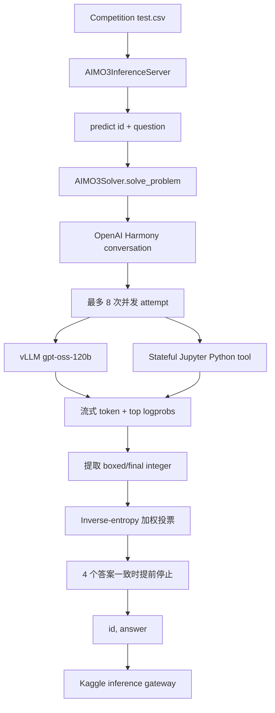

# AI Mathematical Olympiad – Progress Prize 3

<p align="center">
  <a href="https://www.kaggle.com/competitions/ai-mathematical-olympiad-progress-prize-3"></a>
  <a href="https://www.kaggle.com/certification/competitions/ydhdhej/ai-mathematical-olympiad-progress-prize-3"></a>
  
  
  
  
</p>

<p align="center"><a href="./README.md">English</a> | <b>简体中文</b></p>

<div align="center">
  <a href="https://www.kaggle.com/certification/competitions/ydhdhej/ai-mathematical-olympiad-progress-prize-3">
    
  </a>
  <p><em>Kaggle 官方竞赛证书：Bronze Medal，4,138 支队伍中排名第 383</em></p>
</div>

## 项目概览

本仓库保存 **AI Mathematical Olympiad – Progress Prize 3** 的 Kaggle inference Notebook 归档。它不是传统的 supervised-learning 训练项目，而是一个 inference-time reasoning system：本地启动 `gpt-oss-120b`，在需要时调用有状态的 Python/Jupyter sandbox，并将多条候选推理路径聚合为一道题的整数答案。

### 核心亮点

- **Model serving：** 使用 vLLM 提供本地 `gpt-oss-120b` 推理服务，并采用 OpenAI Harmony 消息格式。
- **Tool use：** 每个 worker 使用持久化 Jupyter kernel，向模型提供 `math`、`numpy` 和 `sympy` 执行环境。
- **Inference scaling：** 每道题最多执行 8 次 reasoning attempt，由 16-worker executor 调度，并使用确定性的 derived seed。
- **Answer aggregation：** 使用 inverse-entropy weighted voting，并在 4 次有效答案一致时提前停止。
- **Award evidence：** Bronze Medal，排名 383/4,138；证书和官方链接保存在 `evidence/`。

Notebook 按比赛 inference server 的格式，为每道题输出一个非负整数。完整 leaderboard metric 由 Kaggle 官方定义；本仓库聚焦可执行的提交流水线，不对缺失的本地实验分数进行猜测。

## 系统架构



## 技术实现

### Runtime bootstrap

Notebook 从 Kaggle input mount 安装离线运行环境：

```python
set_env(
    input_archive="/kaggle/input/aimo-3-utils/wheels.tar.gz",
    temp_dir="/kaggle/tmp/setup",
)
```

离线 wheel bundle 提供 `unsloth`、`trl`、`vllm` 和 `openai_harmony`；Notebook 还 import `pandas`、`polars`、`openai`、`transformers`、`jupyter_client` 与 `kaggle_evaluation`。

### Reasoning 与 sandbox 执行

每道题会被转换为 high-reasoning-effort 的 OpenAI Harmony conversation。Solver 可以调用由持久化 Jupyter kernel 支持的 stateful Python tool；tool 输出和执行错误会返回给模型，而 namespace 会在题目之间 reset，避免跨题状态泄漏。

### 并发尝试与答案选择

最终归档配置最多启动 8 次 attempt，由 16-worker executor 调度，每次使用确定性的 derived seed。候选答案从 `\\boxed{...}` 或 `final answer is ...` 中解析，并检查 `0..99999` 范围。系统按每个候选的 `1 / max(mean_entropy, 1e-9)` 累积权重；当 4 次有效 attempt 一致时提前结束。

### Runtime 配置

| 组件 | 归档配置 |
| --- | --- |
| Model | `gpt-oss-120b` |
| Serving | vLLM OpenAI-compatible server |
| Tensor parallelism | `1` |
| GPU memory utilization | `0.96` |
| KV cache | `fp8_e4m3` |
| Context length | `65,536` tokens |
| 每题 attempts | `8` |
| Executor workers | `16` |
| 单次 attempt 最大 turns | `128` |
| Base / high timeout | `300` / `900` 秒 |

## 评估与证据

本仓库包含最终 Notebook、证书证据和官方链接。由于最终提交是 inference pipeline，归档中没有 supervised-training CV 表或完整的 ablation ledger。缺少的 leaderboard 诊断不会用估计值填充。

| 证据项 | 记录 |
| --- | --- |
| Award | Bronze Medal |
| Rank | 383 / 4,138 支队伍 |
| 提交类型 | Kaggle inference Notebook |
| Local CV | 对该 inference-only 系统不适用 |
| 官方证书 | `evidence/aimo-3-bronze-certificate.png` |

## 工程目录

```text
.
├── assets/
│   └── certificate.png                 # README Hero 图片
├── evidence/
│   ├── aimo-3-bronze-certificate.png   # 归档证书图片
│   └── links.md                         # 比赛、Notebook 与证书链接
├── submission/
│   └── aimo-3-gpt-oss-120b-with-tools.ipynb
│                                         # 下载的 Kaggle inference Notebook
├── README.md                            # 英文文档
└── README_zh.md                         # 简体中文文档
```

## 复现说明

### Kaggle 输入

按照 Notebook 使用的路径挂载以下 input：

```text
/kaggle/input/ai-mathematical-olympiad-progress-prize-3/test.csv
/kaggle/input/aimo-3-utils/wheels.tar.gz
/kaggle/input/gpt-oss-120b/transformers/default/1
```

### 运行归档提交

仓库没有独立的 `train.py` 或本地 CLI。请在 Kaggle 中打开 Notebook 并运行全部 cells。最终入口为：

```python
solver = AIMO3Solver(CFG)
inference_server = kaggle_evaluation.aimo_3_inference_server.AIMO3InferenceServer(predict)

if os.getenv("KAGGLE_IS_COMPETITION_RERUN"):
    inference_server.serve()
else:
    inference_server.run_local_gateway(
        ("/kaggle/input/ai-mathematical-olympiad-progress-prize-3/test.csv",)
    )
```

### 复现边界

脱离 Kaggle 复现需要离线 wheel bundle、大型 model checkpoint、CUDA/vLLM 兼容环境和官方 inference-server contract。这些运行时依赖没有打包进仓库。

## 官方链接

- [Competition](https://www.kaggle.com/competitions/ai-mathematical-olympiad-progress-prize-3)
- [Kaggle Notebook](https://www.kaggle.com/code/ydhdhej/aimo-3-gpt-oss-120b-with-tools)
- [Official certificate page](https://www.kaggle.com/certification/competitions/ydhdhej/ai-mathematical-olympiad-progress-prize-3)
- [Official certificate image](https://storage.googleapis.com/kaggle-competition-certificates/31156518/e696320b032f63ca962307d94bbe0394.png)
